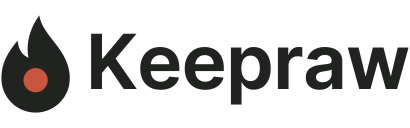
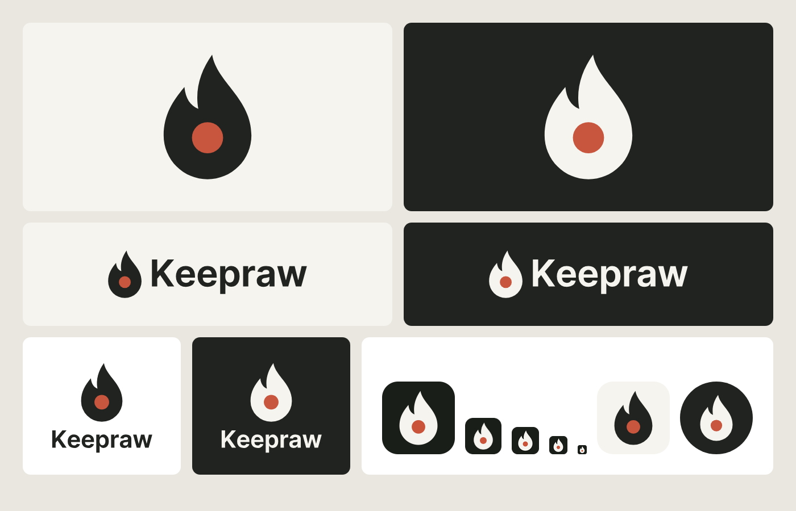
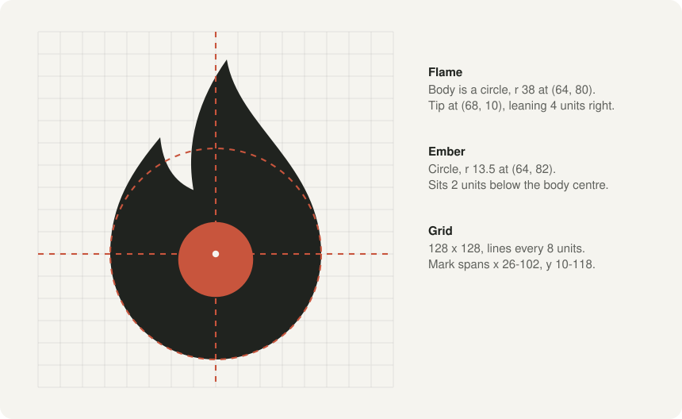
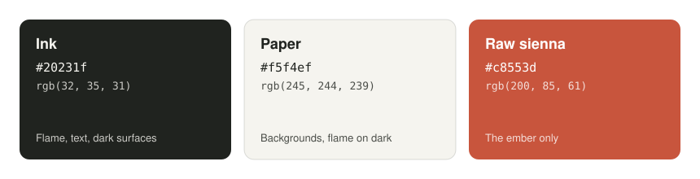
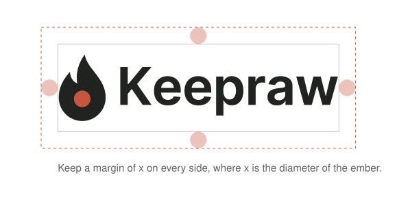
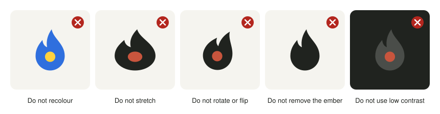

<p align="center">
  <picture>
    <source media="(prefers-color-scheme: dark)" srcset="logo/svg/keepraw-lockup-dark.svg">
    
  </picture>
</p>

# Keepraw brand

The logo, colours and usage rules for [Keepraw](https://keepraw.com) and its projects.



## Idea

Keepraw means keeping the original intention: the reason you started, before it was tidied up for display.

The mark is a flame with an ember at its centre.

- **The ember** is the original intention. It is the only coloured element, and it never changes.
- **The flame** is everything that grows from it: the writing, the tools, the records. It may change shape; the ember does not.
- **Ink and paper** are the colours of a record that is written down and left intact.

The flame is drawn from one circle and three curves, with no gradient or shading, so it stays the same at 16 px and on a poster.

## Construction



The mark is drawn on a 128 x 128 grid. The whole geometry is two shapes:

```svg
<path fill="#20231f" d="M68 10C72 34 102 48 102 80A38 38 0 0 1 26 80C26 62 34 50 44 38C45 48 49 54 56 57C53 40 58 24 68 10Z"/>
<circle fill="#c8553d" cx="64" cy="82" r="13.5"/>
```

## Colour



| Name | Hex | RGB | Use |
|---|---|---|---|
| Ink | `#20231f` | 32, 35, 31 | Flame, wordmark, text, dark surfaces |
| Paper | `#f5f4ef` | 245, 244, 239 | Backgrounds; the flame on dark surfaces |
| Raw sienna | `#c8553d` | 200, 85, 61 | The ember only |

Contrast (WCAG 2.1):

| Pair | Ratio | Suitable for |
|---|---|---|
| Ink on Paper | 14.4 : 1 | All text |
| Raw sienna on Paper | 3.9 : 1 | Graphics and large text only |
| Raw sienna on Ink | 3.7 : 1 | Graphics and large text only |

Raw sienna is an accent. Do not set body text in it, and do not use it for large filled areas.

## Typography

The wordmark is **Keepraw**, capital K, set in [Inter](https://rsms.me/inter/) at weight 650 with -1% tracking. It is stored as outlines, so no font is needed to display it.

Write the name as "Keepraw" in running text.

## Variants

| Variant | Files | Use |
|---|---|---|
| Mark | `keepraw-mark`, `keepraw-mark-on-dark` | The flame alone, transparent background |
| Mono mark | `keepraw-mark-mono-ink`, `keepraw-mark-mono-white` | Where Raw sienna is unavailable (greyscale screens and print). The ember is filled with the background tone, so use it only on Paper (ink) or Ink (white) |
| Cutout mark | `keepraw-mark-cutout-ink`, `keepraw-mark-cutout-white` | A single colour on any background: engraving, stamps, embossing, vinyl, one-ink print. The ember is a hole in the flame |
| Icon | `keepraw-icon-dark`, `keepraw-icon-light` | App icons and favicons (rounded tile) |
| Avatar | `keepraw-avatar-dark`, `keepraw-avatar-light` | Profile pictures; safe for circular crops |
| Lockup | `keepraw-lockup-light`, `keepraw-lockup-dark` | Mark and wordmark side by side, transparent |
| Lockup with background | `keepraw-lockup-light-bg`, `keepraw-lockup-dark-bg` | The same, on Paper or Ink |
| Stacked | `keepraw-stacked-light`, `keepraw-stacked-dark` | Mark above wordmark, for narrow spaces |

`light` variants are for light backgrounds and `dark` variants are for dark backgrounds. The dark icon is the default.

## Clear space and minimum size



- Keep a margin equal to the diameter of the ember on every side.
- Minimum size: 16 px for the icon, 24 px high for the lockup.

## Misuse



## Files

```
logo/svg/    vector masters
logo/png/    raster exports (icons at 16, 32, 48, 180, 192 and 512 px)
favicon/     favicon.ico (16, 32, 48), favicon.svg, apple-touch-icon.png
docs/        figures used on this page
products/    product-specific marks and assets (see below)
scripts/     build.py regenerates everything above
```

## Products

Product marks follow the same 128 x 128 grid and fixed `#c8553d` ember:

- [Keepraw Fly](products/fly/README.md) — Great-Circle Arc mark, Aviation (`#0c0a24`) app icons, favicons and lockups (`products/fly/`).

For a website:

```html
<link rel="icon" href="/favicon.ico" sizes="48x48">
<link rel="icon" href="/favicon.svg" type="image/svg+xml">
<link rel="apple-touch-icon" href="/apple-touch-icon.png">
```

## Rebuilding

Every file is generated from the geometry and colours at the top of `scripts/build.py`. Change them there, not in the output files.

```sh
pip install fonttools brotli
python3 scripts/build.py --font path/to/Inter-roman.var.woff2
```

The script also needs Google Chrome (headless) and ImageMagick to render the PNG files.

## Usage

The Keepraw name and logo are the property of Keepraw. All rights reserved.

You may use the unmodified logo to refer or link to Keepraw. You may not alter it, use it as the logo of another project or product, or use it in a way that suggests endorsement by or affiliation with Keepraw.

Open-source licences on Keepraw repositories cover the code only; they do not grant rights to the name or logo.

The wordmark uses outlines from Inter, which is licensed under the [SIL Open Font License 1.1](https://github.com/rsms/inter/blob/master/LICENSE.txt).
