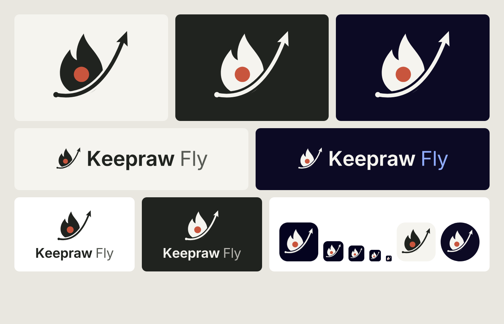

<p align="center">
  <picture>
    <source media="(prefers-color-scheme: dark)" srcset="logo/svg/keepraw-fly-lockup-dark.svg">
    
  </picture>
</p>

# Keepraw Fly brand

Product brand assets for [Keepraw Fly](https://github.com/keepraw/Keepraw-Fly), derived from the core Keepraw mark in [`../../scripts/build.py`](../../scripts/build.py).



## Idea

Keepraw Fly keeps the exact Keepraw flame and `#c8553d` ember intact, pairing them with a great-circle route arc and heading nose sweeping upward along the lower-right flank.

- **The ember (`#c8553d`)** remains the sole brand accent colour.
- **The great-circle arc** uses the same foreground colour as the flame (Ink on light surfaces, Paper on dark/Aviation surfaces), separated by a transparent mask gap so it works cleanly on any background.
- **Aviation surface (`#0c0a24`)** is the default app icon tile for Keepraw Fly; Ink (`#20231f`) and Paper (`#f5f4ef`) tiles are also provided for neutral surfaces.

## Variants

| Variant | Files | Use |
|---|---|---|
| Mark | `keepraw-fly-mark`, `keepraw-fly-mark-on-dark` | Flame + great-circle arc, transparent background |
| Mono mark | `keepraw-fly-mark-mono-ink`, `keepraw-fly-mark-mono-white` | Greyscale screens and print |
| Cutout mark | `keepraw-fly-mark-cutout-ink`, `keepraw-fly-mark-cutout-white` | Single-colour stamps, embossing and passport seals |
| Icon | `keepraw-fly-icon-aviation`, `keepraw-fly-icon-dark`, `keepraw-fly-icon-light` | App icons and favicons (`icon-aviation` is the default) |
| Avatar | `keepraw-fly-avatar-aviation`, `keepraw-fly-avatar-dark`, `keepraw-fly-avatar-light` | Circular profile crops |
| Lockup | `keepraw-fly-lockup-light`, `keepraw-fly-lockup-dark` | Transparent horizontal lockup (`Keepraw` 650 + `Fly` 400) |
| Lockup with background | `keepraw-fly-lockup-light-bg`, `keepraw-fly-lockup-dark-bg`, `keepraw-fly-lockup-aviation-bg` | Lockup on Paper, Ink or Aviation surface |
| Stacked | `keepraw-fly-stacked-light`, `keepraw-fly-stacked-dark` | Mark above `Keepraw Fly` for narrow spaces |

## Rebuilding

```sh
python3 scripts/build.py --font path/to/InterVariable.ttf --product fly
```
